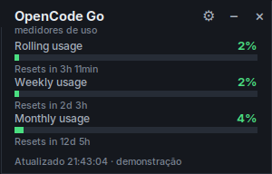

# simple-opencode-usage

Cartão flutuante com os medidores de uso do **OpenCode Go** no Linux — Rolling,
Weekly e Monthly — conectado em tempo real, com ícone na bandeja e tela de
configurações.



Projeto não oficial, sem vínculo com o OpenCode.

## Recursos

- Medidores **Rolling usage**, **Weekly usage** e **Monthly usage** com
  porcentagem, barra colorida e contagem regressiva para o reset.
- Janela sem moldura, sempre no topo, arrastável e com duplo clique para abrir
  o console do OpenCode.
- **Bandeja do sistema** (StatusNotifierItem/DBusMenu): o botão `–` recolhe o
  cartão e deixa o ícone na barra; o menu da bandeja tem *Mostrar/Recolher*,
  *Configurações*, *Atualizar agora* e *Fechar*.
- **Configurações** (⚙): chave de API, tamanho de 80% a 160%, transparência de
  30% a 100%, intervalo de atualização, iniciar com o computador e iniciar
  recolhido.
- Início automático opcional via `~/.config/autostart` (nada global é ativado
  sem a sua escolha).
- Instância única: abrir de novo apenas traz a janela existente.
- Modo `--once` que imprime JSON (útil para Waybar, scripts e monitoramento).

Se a extensão de bandeja não estiver disponível, o `–` transforma o cartão em
uma pílula compacta com os três percentuais; um clique restaura.

## Instalação pelo `.deb`

Baixe o pacote mais recente em
<https://github.com/Cliffordreis/simple-opencode-usage/releases/latest> e instale:

```bash
sudo apt install ./simple-opencode-usage_1.0.2_all.deb
```

O `apt` instala as dependências (`python3-tk`, `python3-gi`). O aplicativo
aparece no menu como **OpenCode Go Usage**.

Para gerar o pacote a partir do código:

```bash
./packaging/build-deb.sh
sudo apt install ./dist/simple-opencode-usage_1.0.2_all.deb
```

## Rodar sem instalar

```bash
python3 simple_opencode_usage.py
```

Requisitos: Python 3.9+, Tkinter e PyGObject (Gio). Em ambientes com bandeja
StatusNotifierItem (GNOME/Zorin com a extensão AppIndicator, KDE etc.) o ícone
aparece automaticamente.

## Como iniciar

- Pelo menu de aplicativos: **OpenCode Go Usage**;
- ou pelo terminal: `simple-opencode-usage`;
- ou, rodando do código: `python3 simple_opencode_usage.py`.

Opções:

```bash
simple-opencode-usage              # abre o cartão
simple-opencode-usage --minimized  # inicia só com o ícone na bandeja
simple-opencode-usage --settings   # abre as configurações junto
simple-opencode-usage --demo       # dados simulados (sem rede)
simple-opencode-usage --once       # imprime JSON e sai
simple-opencode-usage --version
```

## Bandeja

- `–` recolhe o cartão para a bandeja.
- Clique no ícone da bandeja para abrir o menu:
  - **Mostrar** / **Recolher**
  - **Configurações…**
  - **Atualizar agora**
  - **Fechar**
- `×` no cartão encerra o aplicativo.
- `Esc` recolhe; `Ctrl+Q` encerra.

## Configurações

Abra pelo ⚙ no cartão, pelo menu da bandeja ou com `--settings`.

| Opção | Padrão | Descrição |
|---|---|---|
| Chave de API | automática | campo opcional, com botão **Testar** |
| Tamanho | 100% | 80% a 160% |
| Transparência | 96% | 30% a 100% |
| Intervalo | 30 s | 10 s a 300 s |
| Iniciar com o computador | desligado | cria/remove `~/.config/autostart/simple-opencode-usage.desktop` |
| Iniciar recolhido | desligado | usado pelo autostart |

As configurações ficam em `~/.config/simple-opencode-usage/config.json`
(posição da janela, tamanho, transparência, intervalo). A chave só é gravada
nesse arquivo local se você digitá-la na tela de configurações.

## Chave de API

A chave é procurada, nesta ordem:

1. variável de ambiente `OPENCODE_GO_API_KEY` ou `OPENCODE_API_KEY`;
2. campo `api_key` do config local (somente se definido por você);
3. banco de credenciais do OpenCode
   (`~/.local/share/opencode/opencode.db`, integração `opencode-go`).

Nada disso vai para o repositório: o config local fica fora do projeto, não há
telemetria e a chave nunca é impressa em logs. O script
`packaging/check-no-secrets.sh` varre os arquivos versionados e o histórico do
git antes de publicar.

## Uso em scripts / Waybar

```bash
simple-opencode-usage --once
```

```json
{
  "rolling": {"percent": 1, "resetsAt": "2026-10-20T03:09:25+00:00"},
  "weekly": {"percent": 1, "resetsAt": "2026-10-26T00:00:00+00:00"},
  "monthly": {"percent": 4, "resetsAt": "2026-11-17T20:14:50+00:00"}
}
```

Exemplo de módulo para Waybar:

```json
"custom/opencode": {
  "exec": "simple-opencode-usage --once | jq -r '\"R \\(.rolling.percent)% · W \\(.weekly.percent)% · M \\(.monthly.percent)%\"'",
  "interval": 60,
  "tooltip": false
}
```

## Desinstalar

```bash
sudo apt remove simple-opencode-usage
rm -rf ~/.config/simple-opencode-usage
rm -f ~/.config/autostart/simple-opencode-usage.desktop
```

## Notas

- O endpoint de uso (`/inference/go/v1/usage`) é o mesmo usado pelo console web
  do OpenCode; ele não é documentado publicamente e pode mudar. O widget mostra
  o erro em vez de inventar dados.
- A API oficial informa a porcentagem em números inteiros; o console calcula
  com microcentavos e arredonda para cima, então o cartão pode ficar até 1 ponto
  abaixo do site. Os horários de reset seguem a mesma regra do console
  (arredondados para o próximo minuto).
- O ícone da bandeja usa StatusNotifierItem; no GNOME é necessária a extensão
  AppIndicator (já presente no Zorin/Ubuntu).
- Testado em Zorin OS (GNOME/Wayland com XWayland) e X11.

## Licença

MIT — veja [LICENSE](LICENSE).
